# ⚡ Awesome Database Storage & Memory Optimization

<p align="center">
  
</p>

<p align="center">
  <a href="https://github.com/ishandutta2007/Awesome-Awesome-Awesome"></a>
  <a href="https://discord.gg/jc4xtF58Ve"></a>
  <a href="https://github.com/ishandutta2007/Awesome-Database-Storage-Memory-Optimization/stargazers"></a>
  <a href="https://github.com/ishandutta2007/Awesome-Database-Storage-Memory-Optimization/network/members"></a>
  <a href="https://github.com/ishandutta2007/Awesome-Database-Storage-Memory-Optimization/blob/main/LICENSE"></a>
  <a href="https://github.com/ishandutta2007"></a>
</p>

---

## 📌 Overview & Architecture Focus

Welcome to **Awesome Database Storage & Memory Optimization** — a curated index of high-performance **In-Memory Databases (IMDB)**, distributed **caching layers**, **low-latency key-value stores**, and **storage engines**. Designed for backend architects, site reliability engineers (SREs), and database administrators (DBAs) optimizing high-throughput transactional and analytical systems.

Whether you are scaling sub-millisecond retrieval workloads, evaluating BSD-licensed Redis alternatives like **Valkey**, extracting multi-threaded performance from **Dragonfly**, or designing embedded storage pipelines with **RocksDB** and **Pebble**, this repository serves as your production-ready reference.

---

## 📑 Table of Contents
- [📊 Sector Overview & Market Dynamics](#-sector-overview--market-dynamics)
- [☁️ SaaS & Managed Hosted Platforms](#️-saas--managed-hosted-platforms)
- [💻 Open-Source GitHub Projects](#-open-source-github-projects)
- [💡 Architectural Decision Guide](#-architectural-decision-guide)
- [🤝 How to Contribute](#-how-to-contribute)
- [❤️ Support & Community](#️-support--community)
- [📈 Star History](#-star-history)
- [⚖️ Disclaimer](#️-disclaimer)

---

## 📊 Sector Overview & Market Dynamics

The global in-memory database and caching market is valued at approximately **$10.4B – $13.2B** and is projected to expand rapidly to **$30B – $45B+** over the next decade (growing at a 13.7% – 19.4% CAGR), driven by sub-millisecond data retrieval demands, microservices scaling, and real-time AI context architectures. 

The sector exhibits a **hybrid market concentration**:
- **High Concentration at the Top Tier:** Foundational infrastructure is heavily anchored by hyperscale cloud service providers (Microsoft Azure, Amazon AWS, and Google Cloud) offering fully managed distributed cache tiers.
- **Moderate Fragmentation in Specialized Engines:** The specialized caching, serverless memory, and embedded storage engine segments remain moderately fragmented and fiercely contested by open-source innovators (e.g., Valkey, Dragonfly, RocksDB, Pebble, Badger).

---

## ☁️ SaaS & Managed Hosted Platforms

Below is a curated comparison of leading enterprise managed caching and in-memory cloud platforms, sorted by parent company size (valuation / revenue):

| Product | Company Size (Valuation / Revenue) | Starting Pricing (Specific Tier) | Free Tier / Trial Limits | Key Architecture & Features |
| :--- | :--- | :--- | :--- | :--- |
| **[Microsoft Azure Cache for Redis](https://azure.microsoft.com/en-us/products/cache/)** | ~$3.1T Market Cap / ~$245B Annual Revenue (Microsoft) | **$16.06/month** (Basic C0, 250 MB cache, single node, ~$0.022/hr) | **30-day trial ($200 credits)**; no permanent free tier. Basic C0 is hourly pay-as-you-go (~$0.022/hr) | Fully managed Redis for Azure workloads. Microsoft is progressively transitioning users toward Azure Managed Redis. |
| **[Amazon ElastiCache](https://aws.amazon.com/elasticache/)** | ~$2.2T Market Cap / ~$105B AWS Run-Rate (Amazon) | **$6.13/month** (Serverless Valkey, $0.084/GB-hr with 100 MB min in us-east-1) or **~$9.34/month** (`cache.t4g.micro` node) | **12-month free tier: 750 hrs/month** of `cache.t2.micro` or `cache.t3.micro` (Serverless excluded, 0 free hrs) | Managed caching supporting Valkey and Redis OSS with cross-AZ high availability and Serverless auto-scaling. |
| **[Google Cloud Memorystore](https://cloud.google.com/memorystore)** | ~$2.1T Market Cap / ~$330B Annual Revenue (Alphabet) | **$35.77/month** (Basic M1 tier, 1 GiB memory, ~$0.049/hr) | **90-day trial ($300 credits)** across GCP; no permanent free tier for Memorystore | GCP-managed Redis and Valkey instances featuring zero-egress VPC peering for low network latency. |
| **[Redis Cloud](https://redis.io/cloud/)** | ~$2.0B Valuation (Series G) / >$300M ARR (Redis Ltd.) | **$5.00/month** (Redis Flex, RAM + SSD tier) or **$18.00/month** (Redis Essentials 1 GB, 100% RAM) | **Permanent free tier: 30 MB storage**, 1 database, 30 concurrent connections, no credit card required | Managed Redis supporting advanced modules (RediSearch, RedisJSON, Vector Search) and Active-Active geo-replication. |
| **[Dragonfly Cloud](https://www.dragonflydb.io/cloud)** | ~$50M – $100M Est. Valuation / ~$3.6M ARR ($21M Total Raised) | **$8.00/GB/month** (AWS us-east-1, billed hourly at ~$0.011/GB-hr; BYOC Enterprise starts at $2,000/mo) | **$100 free cloud credits** trial upon sign-up (no permanent free tier) | Multi-threaded Redis-compatible engine delivering up to 25x single-instance throughput with memory defragmentation. |
| **[Momento Cache](https://www.gomomento.com/)** | ~$60M Est. Valuation / Early-Stage Venture ($30M Total Raised) | **$0.50/GB** overage or **$13.00/GB-month** (Flex capacity with 200 GB transfer included) | **Permanent free tier: 5 GB/month** data transfer (inbound + outbound) & 5M pub/sub ops/mo; no credit card required | True serverless cache requiring zero node sizing, cluster provisioning, or pre-allocated capacity. |

### 🔍 Platform Cost & Operational Caveats
- **Hidden Minimums in Managed Caching:** Empty ElastiCache Serverless Valkey costs ~$6.13/mo (100 MB minimum), whereas ElastiCache Redis OSS enforces a 1 GB minimum (~$91.25/mo).
- **RAM vs. Hybrid Latency:** Redis Cloud Flex ($5/mo) keeps hot keys in RAM and pushes cold keys to SSD, introducing latency spikes on cold reads compared to full in-memory Essentials ($18/mo).
- **Provisioned Minimum Bands:** Google Cloud Memorystore's smallest instance starts at M1 (1 GiB) at $35.77/mo, running 24/7 with no scale-to-zero capability.
- **Licensing Governance:** Dragonfly Cloud uses a Business Source License (BSL), restricting users from running competing DBaaS offerings, unlike Valkey's unrestricted open-source BSD license.

---

## 💻 Open-Source GitHub Projects

Curated list of production-grade open-source caching layers, in-memory databases, and high-performance embedded storage engines. **Sorted by GitHub_Stars (descending)**:

| # | Project & Stars_Badge | Category & Architecture | Key Strengths & Use Cases | License |
| :-: | :--- | :--- | :--- | :--- |
| 1 | **[Redis](https://github.com/redis/redis)** <br> [](https://github.com/redis/redis/stargazers) | In-Memory Data Store & Cache | The foundational in-memory key-value store. Supports strings, hashes, lists, sets, sorted sets, streams, Pub/Sub, Lua scripts, and transactions. Highly adopted across global engineering organizations. | RSALv2 / SSPL |
| 2 | **[RocksDB](https://github.com/facebook/rocksdb)** <br> [](https://github.com/facebook/rocksdb/stargazers) | Embedded LSM-Tree Key-Value Engine | High-performance embedded key-value database engine optimized for fast storage (SSDs, NVMe). Powers modern distributed databases like CockroachDB, TiKV, Kafka Streams, and Apache Flink. | Apache-2.0 / GPL-2.0 |
| 3 | **[Dragonfly](https://github.com/dragonflydb/dragonfly)** <br> [](https://github.com/dragonflydb/dragonfly/stargazers) | Multi-Threaded In-Memory Store | Modern Redis/Memcached replacement written in C++. Uses a shared-nothing multi-threaded architecture to scale across dozens of CPU cores on a single instance with zero lock contention. | BSL-1.1 |
| 4 | **[Valkey](https://github.com/valkey-io/valkey)** <br> [](https://github.com/valkey-io/valkey/stargazers) | Open-Source In-Memory Data Store | The community-driven, Linux Foundation-backed successor to open-source Redis. Backed by AWS, Google, Oracle, Ericsson, and Heroku. Retains full API compatibility with guaranteed open-source governance. | BSD-3-Clause |
| 5 | **[BadgerDB](https://github.com/dgraph-io/badger)** <br> [](https://github.com/dgraph-io/badger/stargazers) | Pure Go Embedded Key-Value Store | LSM-tree database engine based on the WiscKey paper, separating keys from values to drastically reduce write amplification and maximize SSD throughput. Ideal for high-scale Go systems. | Apache-2.0 |
| 6 | **[Memcached](https://github.com/memcached/memcached)** <br> [](https://github.com/memcached/memcached/stargazers) | Distributed Memory Object Cache | High-performance, distributed memory caching system designed to speed up dynamic web applications by alleviating database load. Simple, ultra-fast, and battle-tested for decades. | BSD-3-Clause |
| 7 | **[KeyDB](https://github.com/Snapchat/KeyDB)** <br> [](https://github.com/Snapchat/KeyDB/stargazers) | Multithreaded Redis Fork | Multithreaded Redis fork developed by Snapchat that achieves up to 5x higher throughput by utilizing all CPU cores. Supports MVCC, active-replication, and sub-key expiration. | BSD-3-Clause |
| 8 | **[BigCache](https://github.com/allegro/bigcache)** <br> [](https://github.com/allegro/bigcache/stargazers) | Fast In-Memory Cache for Go | High-performance Go cache designed for gigabytes of data with zero GC (Garbage Collection) overhead. Writes entries directly into raw byte slices to avoid GC sweep pauses. | Apache-2.0 |
| 9 | **[Pebble](https://github.com/cockroachdb/pebble)** <br> [](https://github.com/cockroachdb/pebble/stargazers) | Go Key-Value Engine (RocksDB-inspired) | LevelDB/RocksDB-inspired LSM-tree key-value store written in Go by Cockroach Labs. Designed for CockroachDB to eliminate Cgo overhead while maintaining predictable low latencies. | Apache-2.0 |
| 10 | **[Apache Ignite](https://github.com/apache/ignite)** <br> [](https://github.com/apache/ignite/stargazers) | Distributed In-Memory Computing Grid | In-memory data grid and distributed transactional database that provides distributed ACID transactions, distributed ANSI-99 SQL querying, and high-speed in-memory caching. | Apache-2.0 |
| 11 | **[FastCache](https://github.com/VictoriaMetrics/fastcache)** <br> [](https://github.com/VictoriaMetrics/fastcache/stargazers) | Zero-GC Thread-Safe In-Memory Cache | Ultra-fast thread-safe memory cache from VictoriaMetrics. Designed to hold millions of entries without triggering Go GC overhead, providing up to 40M ops/sec per core. | Apache-2.0 |
| 12 | **[Hippocampus](https://github.com/fastbean-au/hippocampus)** <br> [](https://github.com/fastbean-au/hippocampus/stargazers) | Biological Retention & AI Memory Engine | Significance-based memory retention engine for AI agents and audit logs. Uses recall-based reinforcement and periodic consolidation instead of simple TTL expiration. | MIT |

---

## 💡 Architectural Decision Guide

When choosing an in-memory or storage optimization engine, consider these architectural trade-offs:

```
                                  Workload Memory Requirement
                                              |
                   +--------------------------+--------------------------+
                   |                                                     |
             In-Memory Caching                                 Persistent Storage Engine
                   |                                                     |
       +-----------+-----------+                             +-----------+-----------+
       |                       |                             |                       |
  BSD Open-Source       Extreme Multi-Core              Go / Microservices       C++ / Enterprise
       |                       |                             |                       |
    Valkey                 Dragonfly                  Pebble / BadgerDB           RocksDB
```

- **For True Open Source & Redis Drop-In**: Choose **Valkey** (BSD-3-Clause, governed by the Linux Foundation with AWS/Google sponsorship).
- **For Maximum Single-Node Throughput**: Choose **Dragonfly** (handles millions of queries per second across dozens of cores via shared-nothing thread architecture).
- **For Low-Latency Embedded Storage on SSD/NVMe**: Choose **RocksDB** (C++) or **Pebble** (Go), utilizing Log-Structured Merge-trees (LSM) for sequential writes.
- **For Zero-GC In-Memory Go Applications**: Choose **FastCache** or **BigCache** to eliminate garbage collection latency spikes when managing tens of gigabytes in RAM.

---

## 🤝 How to Contribute

Contributions are welcome! Help keep this ecosystem comprehensive, accurate, and up-to-date.

1. 🍴 **Fork the repository**
2. 🌿 **Create a feature branch** (`git checkout -b feature/add-new-storage-engine`)
3. ✍️ **Add or edit entries in `README.md`** (follow standard markdown formatting and include factual benchmarks/pricing)
4. 🚀 **Commit your changes** (`git commit -m "Add EngineName to Open-Source section"`)
5. 📤 **Push to branch** (`git push origin feature/add-new-storage-engine`)
6. 🔀 **Open a Pull Request** with a brief summary of the project and why it belongs here.

---

## ❤️ Support & Community

If you found this curated list helpful for your database architecture or infrastructure planning:
- ⭐ **Star this repository** to help others discover it!
- 🍴 **Fork and share** with your backend and infrastructure teams.
- 💬 **Join our Discord**: [Discord Community](https://discord.gg/jc4xtF58Ve)
- ☕ **Buy me a coffee / Support my open-source work**: Sponsor directly on [GitHub Sponsors (@ishandutta2007)](https://github.com/sponsors/ishandutta2007). Your support helps maintain and update curated resources!

---

## 📈 Star History

[](https://www.star-history.com/#ishandutta2007/Awesome-Database-Storage-Memory-Optimization&type=date&legend=top-left)

---

## ⚖️ Disclaimer

- This is an independent, **community-curated** technical list — not an official endorsement of any vendor or service.
- **Cache Security**: In-memory data stores typically handle sensitive cached data and session tokens. Always enforce network isolation (VPC peering, private subnets), TLS encryption in-transit, and strong authentication.
- **Pricing & Licensing Verification**: Pricing models and software licenses change frequently. Always confirm current license terms (e.g., BSD vs. BSL vs. SSPL) and cloud pricing calculators before deploying to production environments.

---

<p align="center">
  <b>Built for Backend Engineers, SREs, and Database Architects.</b><br>
  Optimizing throughput, latency, and memory footprints everywhere.
</p>
